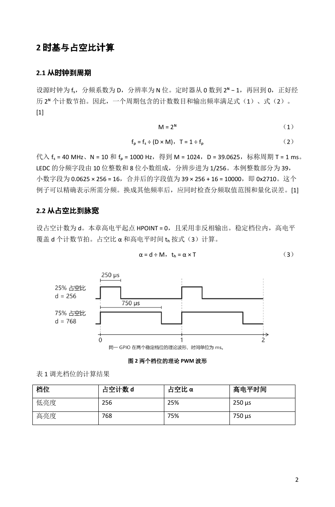
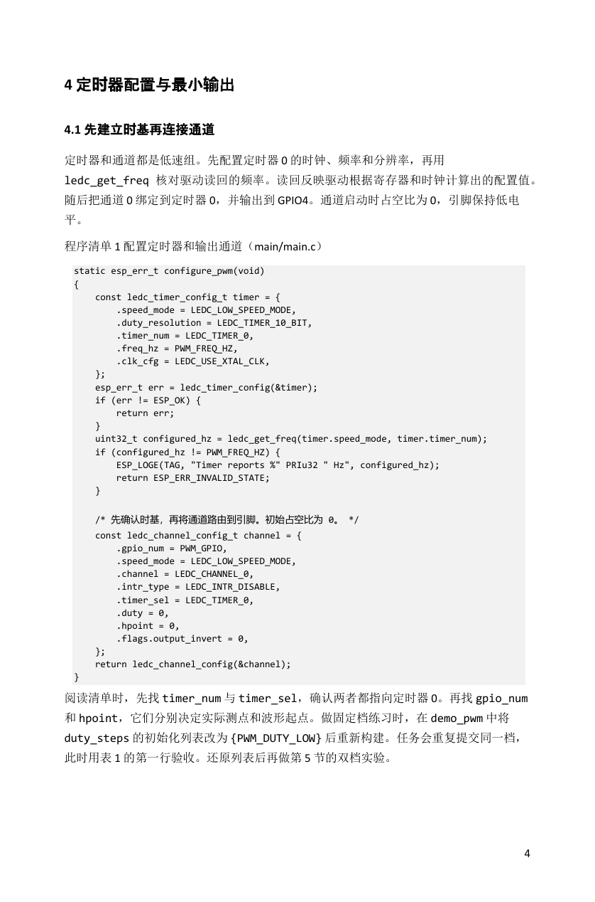
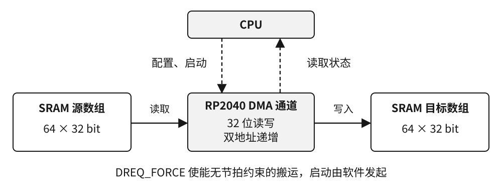

# 芯片外设教材与代码制作

把芯片外设的工作原理、参数计算、C 代码和实验步骤写成能跟做的教材，并交付可编辑插图与可重建工程。

**[如果你是 AI 助手](#如果你是-ai-助手)** · **[如果你是读者](#如果你是读者)** · [样章成果](#样章成果) · [资料检索与 RAG](references/retrieval.md) · [v1.1 下载](https://github.com/yimisaii/chip-module-textbook/releases/tag/v1.1)

本仓库目前为私有，仅有访问权限的账号可以下载。`main` 持续更新说明与展示，`v1.1` 标签和 Release 保留首发快照。

## 如果你是 AI 助手

### 1. 下载并安装到目标项目

先确定用户正在使用的宿主，以及要安装到哪个项目。在**目标项目根目录**运行下面的命令；示例将整份仓库直接安装到 Codex 支持的项目级目录：

```sh
gh auth status
gh repo clone yimisaii/chip-module-textbook .agents/skills/chip-module-textbook
```

需要 Git、GitHub CLI，以及有本仓库访问权限的登录账号。未登录时先由使用者完成 `gh auth login`。已有 Git HTTPS 凭据时也可用：

```sh
git clone https://github.com/yimisaii/chip-module-textbook.git .agents/skills/chip-module-textbook
```

其他宿主把上面命令的目标目录换成下表路径。安装后，这个目录中应直接有 `SKILL.md`、`references/`、`assets/`、`scripts/` 和 `examples/`。已有同名目录时，先检查其来源和未提交修改，再决定更新。

| 宿主 | 项目内安装目录 | 使用入口 |
| --- | --- | --- |
| Codex | `.agents/skills/chip-module-textbook/` | 输入 `$chip-module-textbook`，或从 Skills 列表选择 |
| Claude Code | `.claude/skills/chip-module-textbook/` | 输入 `/chip-module-textbook` 后附任务 |
| VS Code Copilot | `.github/skills/chip-module-textbook/` | 在 Chat 的 `/` 选择器中选择 Skill |
| Gemini CLI | `.agents/skills/chip-module-textbook/` | 用 `/skills list` 检查，在任务中点名该 Skill |
| Cursor | `.cursor/skills/chip-module-textbook/` | 在 Agent 的 `/` 选择器中选择 Skill |

路径和调用方式的官方依据、其他可选目录及依赖见[跨宿主使用指南](references/portability.md)。各宿主的原生发现与激活尚未逐一实测。

无终端或原生 Skills 功能时，可下载 [v1.1 ZIP](https://github.com/yimisaii/chip-module-textbook/releases/tag/v1.1)，解压后按路径读取 `SKILL.md`。只支持对话附件时，提供 `SKILL.md`、编写方法、对应芯片资料卡和所需原厂资料，按同一流程工作。

### 2. 读取工作流，再接收具体任务

先读 [SKILL.md](SKILL.md)。根据任务按需读取[教材编写方法](references/textbook-workflow.md)、[章节模板](assets/chapter-template.md)、[资料索引](references/source-catalog.md)和对应器件资料。包内路径相对于 `SKILL.md` 所在目录解析。

开始写作前，确定芯片完整料号、板卡与接线、外设、SDK 版本、IDE、读者基础和实验成功现象。实现依据使用当前芯片的原厂手册、勘误及匹配版本的 SDK 源码。

可以把下面的任务直接发给助手；第一行路径换成实际安装位置：

```text
请读取 .agents/skills/chip-module-textbook/SKILL.md 并按其工作流完成任务。
芯片与板卡：ESP32-C3-DevKitM-1。
外设与目标：LEDC，GPIO4 外接 LED，实现 1 kHz 的 25%/75% 双档输出。
环境：ESP-IDF v5.3.4，C，使用已安装的工具链。
读者：能读基础 C，刚开始学习外设。
交付：中文小章、可编辑 SVG、与源码同源的关键代码清单、
可重建工程、实验步骤与练习、分层验证记录。
用原厂资料核对时钟、引脚、占空计数和更新时刻，列出来源。
当前环境无法完成的目标构建或实板测量标为待验证。
```

### 3. 检索对应芯片的资料

从安装目录运行。检索脚本只用 Python 3 标准库，无需额外服务或 API Key：

```sh
python -X utf8 scripts/retrieve.py --chip stm32u575 --peripheral dma --sdk hal1-1.6.3 "BNDT 字节"
python -X utf8 scripts/retrieve.py --chip rp2040 --peripheral dma --sdk pico-sdk-2.2.0 "transfer_count 64"
python -X utf8 scripts/retrieve.py --chip esp32c3 --peripheral ledc --sdk esp-idf-5.3.4 "HPOINT 256 768"
```

本机解释器叫 `python3` 时，将 `python` 换成 `python3`。结果带资料卡路径、行号、来源和命中段落。先筛选芯片、外设与 SDK，再匹配关键词；没有匹配时退出码为 1，应回查当前器件资料。把命中证据交给写作步骤，保留来源定位。

当前提供 Markdown 资料卡与段落级关键词检索。自有 PDF 接入、私有资料库、检索规则及以后接入本地或云端 RAG 的字段约定见[资料检索与 RAG](references/retrieval.md)。

### 4. 交付与复核

按任务交付章稿、图、源码、工程或重建步骤，以及验证记录。程序清单从同版 C 源码抽取；图、算式、表格和代码使用同一组参数。分别记录文稿检查、主机测试、SDK 接口检查、目标编译链接和实板测量。

安装完成后，可从 Skill 根目录检查本地检索：

```sh
python -X utf8 -m unittest discover -s tests
```

Word 生成另需 `python-docx`、SVG 转 PNG 工具和可用的分页预览环境。目标工程按各样例自己的 SDK、IDE 和板卡条件构建，详见[依赖与重建方法](references/portability.md#重建-word-样章)。

## 如果你是读者

### 这个 Skill 可以帮你做什么

它适合编写 MCU、DSP 外设模块教材和配套固件，当前以 C 为主要示例语言。读者可以是刚开始学习外设的学生，也可以是要把实验整理成教材的教师和工程师。

| 想完成的事情 | 可使用的内容 |
| --- | --- |
| 为一颗新芯片编写外设章节 | 从用途、原理与信号路径，讲到参数、寄存器、初始化、应用、实验和习题的工作流 |
| 把代码讲清楚并交付工程 | 实际源码中的关键清单，配置顺序、成功判断和异常路径，SDK 与 IDE 复现步骤 |
| 制作教材图示 | 可编辑 SVG、信号路径、理论时序和接线图，图表数值与程序一致 |
| 查证器件差异 | 按芯片、外设和 SDK 筛选的资料卡，带原厂小节或源码定位 |
| 复用以往编写经验 | [教材章法审计](references/textbook-benchmark.md)、[返工问题卡](references/failure-cards.md)、[Keil 5 指南](references/keil-mdk5.md) |

原教材用于学习讲解顺序、应用递进和版式。新增芯片时仍需补充它自己的手册、勘误、板卡与 SDK 依据。当前参考书的实际抽查范围、样章与完整教材的差距均记在[教材对照记录](references/textbook-benchmark.md)中。

### 样章成果

**ESP32-C3 LEDC：从原理计算到调光实验。** 9 页 Word、4 张原创图、6 张可编辑表、3 段从 C 文件抽取的程序清单和 6 道练习。下面是同一份 Word 的真实渲染页，可点击查看原尺寸。

| 第 2 页：时钟计算、理论波形与参数表 | 第 4 页：初始化代码与导读 |
| --- | --- |
| [](assets/previews/esp32c3-page-2.png) | [](assets/previews/esp32c3-page-4.png) |

[下载 Word](examples/esp32c3-ledc/chapter.docx) · [阅读 Markdown](examples/esp32c3-ledc/chapter.md) · [C 源码](examples/esp32c3-ledc/main/main.c) · [工程与接线](examples/esp32c3-ledc/README.md) · [验证记录](examples/esp32c3-ledc/VERIFICATION.md)

**RP2040 DMA：同一个实验迁移到另一颗芯片。** 将 64 个 32 位元素在两块 SRAM 数组之间搬运，讲清传输次数、数据宽度、完成判断、超时和逐项校验。下图是样章使用的原创数据路径图，SVG 可继续编辑。



[下载 Word](examples/rp2040-dma/chapter.docx) · [阅读 Markdown](examples/rp2040-dma/chapter.md) · [C 源码](examples/rp2040-dma/src/main.c) · [构建与测试](examples/rp2040-dma/VERIFICATION.md)

**STM32U575 GPIO/EXTI：同一颗芯片换模块。** 用按键中断与消抖检验编写方法，交付小章、信号图、时序图、C 代码和 Keil 工程。

[阅读小章](examples/stm32u575-gpio-exti/chapter.md) · [图与工程入口](examples/stm32u575-gpio-exti/README.md) · [Keil 工程](examples/stm32u575-gpio-exti/project/MDK-ARM/GPIO_EXTI.uvprojx) · [验证记录](examples/stm32u575-gpio-exti/evidence/verification.md)

### 已经验证到哪一步

| 项目 | 已完成 | 待完成 |
| --- | --- | --- |
| 资料检索与打包 | 7 项测试，包内链接检查，解压到独立目录后检索 | 随新芯片补充检索用例 |
| RP2040 DMA | Pico SDK 2.2.0，正常与差异注入版真实 ARM 编译链接 | 上板运行与测量 |
| ESP32-C3 LEDC | ESP-IDF v5.3.4，真实 RISC-V 编译链接，主机逻辑测试；Word 逐页复核 | 烧录、串口与示波器测量 |
| STM32U575 GPIO/EXTI | 6 组主机消抖测试，HAL/CMSIS 接口和工程路径检查 | Keil 编译链接与实板实验 |
| 多助手使用 | 通用文件格式、五个宿主的安装说明，按文件路径完成试作 | 各宿主原生发现与激活实测 |

图中的波形和时间是原理示意或推算，硬件实测以记录为准。完整证据见 [VALIDATION.md](VALIDATION.md)。

### 从哪里开始

先读一个感兴趣的样章，再把[任务示例](#2-读取工作流再接收具体任务)发给助手。想做新芯片时，准备完整料号、板卡、外设目标和原厂资料；想接入自己的教材或 PDF，按[资料接入说明](references/retrieval.md)建立本地资料卡。

原书 PDF、厂商 SDK、工具链与目标构建产物由使用者按出处获取。仓库保留原创章稿、插图、示例、教学笔记和资料定位，目录内的 `private/` 默认由 Git 忽略。
