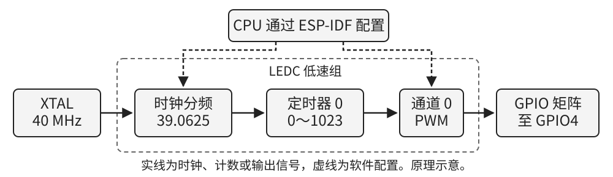
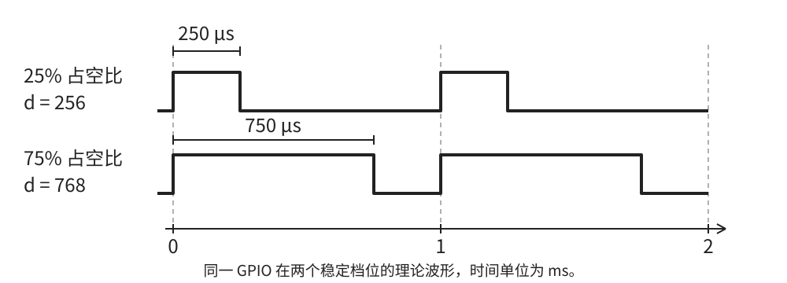
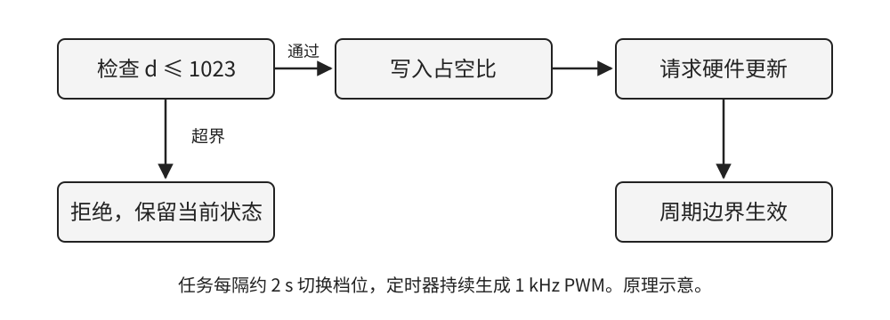
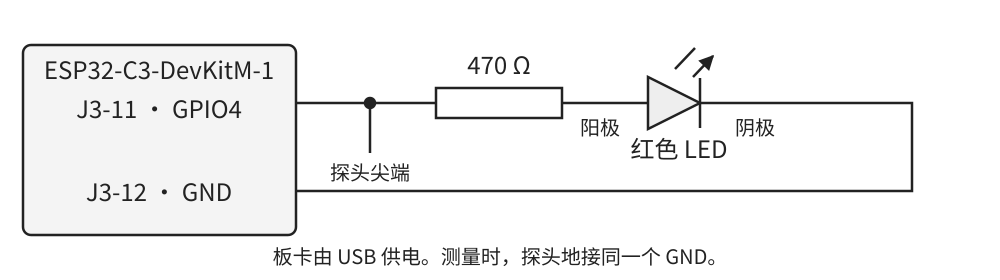

# ESP32-C3 LED PWM 工作原理与调光实验

数字输出在导通和关断之间快速切换时，可以用每个周期的导通时间控制负载。对于普通发光二极管，高电平点亮，低电平熄灭。提高高电平在周期内所占的比例，通常会让 LED 看起来更亮。本章用 ESP32-C3 的 LED PWM 控制器（LEDC）驱动外接红色 LED，目标是在约 1 kHz 的周期波形上获得 25% 和 75% 两个档位，并能用测量和程序日志解释结果。

读者应能阅读 C 结构体与函数返回值。完成本章后，应能从时钟算出周期和分频，从时间指标算出占空比设置，并解释一次软件写入在什么时刻改变引脚输出。

## 1 控制器的结构

LEDC 有四个定时器和六个 PWM 通道。定时器负责把输入时钟分频并循环计数，通道选择一个定时器作为时基，并按计数值产生输出边沿。多个通道可以共用一个定时器。共用时，它们具有相同的周期和计数分辨率，各自仍能选择不同的占空比。ESP32-C3 的 LEDC 使用低速组，配置变化需要软件发起更新。低速组是外设的工作组名称，PWM 频率仍由时钟、分频和计数长度决定。[1][2]

图 1 LEDC 时基与输出路径

本实验用 40 MHz 晶振作源时钟，定时器 0 建立时基，通道 0 输出波形。GPIO 矩阵把通道信号送到 GPIO4。这样，代码可以独立修改通道的占空比，定时器继续保持原来的周期。图 1 的虚线是 CPU 配置路径，实线是配置完成后由硬件持续运行的路径。

@page

## 2 时基与占空比计算

### 2.1 从时钟到周期

设源时钟为 fₛ，分频系数为 D，分辨率为 N 位。定时器从 0 数到 2ᴺ − 1，再回到 0，正好经历 2ᴺ 个计数节拍。因此，一个周期包含的计数数目和输出频率满足式（1）、式（2）。[1]

M = 2ᴺ　　　　　　　　　　　　　　　　（1）

fₚ = fₛ ÷ (D × M)，T = 1 ÷ fₚ　　　　　　（2）

代入 fₛ = 40 MHz、N = 10 和 fₚ = 1000 Hz，得到 M = 1024，D = 39.0625，标称周期 T = 1 ms。LEDC 的分频字段由 10 位整数和 8 位小数组成，分辨步进为 1/256。本例整数部分为 39，小数字段为 0.0625 × 256 = 16，合并后的字段值为 39 × 256 + 16 = 10000，即 0x2710。这个例子可以精确表示所需分频。换成其他频率后，应同时检查分频取值范围和量化误差。[1]

### 2.2 从占空比到脉宽

设占空计数为 d。本章高电平起点 HPOINT = 0，且采用非反相输出。稳定档位内，高电平覆盖 d 个计数节拍。占空比 α 和高电平时间 tₕ 按式（3）计算。

α = d ÷ M，tₕ = α × T　　　　　　　　　（3）

图 2 两个档位的理论 PWM 波形

表 1 调光档位的计算结果

| 档位 | 占空计数 d | 占空比 α | 高电平时间 |
| --- | --- | --- | --- |
| 低亮度 | 256 | 25% | 250 μs |
| 高亮度 | 768 | 75% | 750 μs |

@page

## 3 寄存器与程序设置的对应

### 3.1 时间基准与输出比较

配置定时器时，分辨率决定计数器何时溢出，分频字段决定每个计数节拍的平均时间。通道先选中定时器，再比较计数值与起点 HPOINT 和终点 LPOINT。对于本章两个非零档位，计数到 HPOINT 时输出置高，计数到 LPOINT 时拉低。LPOINT 由 HPOINT 与占空计数相加，本实验的 HPOINT 为 0，因此下降沿出现在第 256 或第 768 个计数处。改变 HPOINT 可以移动脉冲在周期内的起点，修改它之前要确认结束计数是否越过周期边界。[1]

表 2 定时器和通道的关键字段

| 寄存器 | 本章关注的字段或作用 | 程序中的对应 |
| --- | --- | --- |
| `LEDC_CONF_REG` | `APB_CLK_SEL` 选择公共源时钟 | `LEDC_USE_XTAL_CLK` |
| `LEDC_TIMER0_CONF_REG` | `CLK_DIV_TIMER0` 和 `TIMER0_DUTY_RES` 决定时基 | 定时器配置的频率和分辨率 |
| `LEDC_CH0_CONF0_REG` | `TIMER_SEL_CH0` 选时基，`PARA_UP_CH0` 应用新参数 | 通道绑定与请求更新 |
| `LEDC_CH0_HPOINT_REG` | 高电平起始计数 | `hpoint = 0` |
| `LEDC_CH0_DUTY_REG` | `DUTY_CH0[18:4]` 为整数占空计数 | `ledc_set_duty` |
| `LEDC_CH0_DUTY_R_REG` | 读取当前周期使用的占空值 | `ledc_get_duty` |

### 3.2 参数写入和引脚变化

运行中写入占空参数后，还需要请求更新。硬件在计数器下一次溢出、开始新周期时采用新值。因此在调用更新函数后立即读取当前占空比，可能仍读到上一周期的值。应用日志可在提交时记录请求值，示波器则可以验证请求何时影响引脚。寄存器的分频字段和占空字段采用不同的编码，本章用驱动处理编码，只给应用层传入 Hz、分辨率枚举和占空计数。[1][2]

### 3.3 占空比边界

本例将输入限定在 0～1023。这个限制属于本实验的接口约定，便于统一用一个计数周期中的整数位置表示档位。ESP-IDF v5.3.4 的 10 位 API 示例范围包括 1024；ESP32-C3 在使用外设最大分辨率时另有满量程溢出限制。两种条件应分别判断。本章的 1024 测试验证的是应用保护，测试在调用驱动前结束。[2]

@page

## 4 定时器配置与最小输出

### 4.1 先建立时基再连接通道

定时器和通道都是低速组。先配置定时器 0 的时钟、频率和分辨率，再用 `ledc_get_freq` 核对驱动读回的频率。读回反映驱动根据寄存器和时钟计算出的配置值。随后把通道 0 绑定到定时器 0，并输出到 GPIO4。通道启动时占空比为 0，引脚保持低电平。

程序清单 1 配置定时器和输出通道（main/main.c）

@code main/main.c configure_pwm

阅读清单时，先找 `timer_num` 与 `timer_sel`，确认两者都指向定时器 0。再找 `gpio_num` 和 `hpoint`，它们分别决定实际测点和波形起点。做固定档练习时，在 `demo_pwm` 中将 `duty_steps` 的初始化列表改为 `{PWM_DUTY_LOW}` 后重新构建。任务会重复提交同一档，此时用表 1 的第一行验收。还原列表后再做第 5 节的双档实验。

@page

### 4.2 写入占空比并请求更新

把输入校验放在写寄存器之前，可以使非法请求有明确结果。合法输入先调用 `ledc_set_duty`，若成功再调用 `ledc_update_duty`。第一个调用准备新值，第二个调用请求硬件应用。应用任务独占通道 0，所以两步之间没有其他任务竞争。若同一通道由多个任务操作，应重新设计任务所有权或使用该 SDK 提供的线程安全更新接口。[2]

图 3 占空值的校验与生效路径

程序清单 2 校验输入并提交占空值（main/main.c）

@code main/main.c set_pwm_duty

表 3 三类返回结果和调用方动作

| 发生位置 | 可观察结果 | 调用方动作 |
| --- | --- | --- |
| 输入为 1024 | 返回 `ESP_ERR_INVALID_ARG`，本次没有写驱动 | 检查应用上限和数据来源 |
| 合法输入，两个调用成功 | 请求已提交，随后新周期生效 | 等待稳定档位后观察 |
| 合法输入，驱动报错 | 返回相应错误码 | 记录错误，运行阶段尝试停通道并置低 |

@page

## 5 双档调光应用

应用从 `app_main` 进入，先配置定时器与通道，再提交一次 1024，验证越界路径会返回 `ESP_ERR_INVALID_ARG`。通过后进入两个档位的循环。每次提交新档位后，串口打印 GPIO、配置频率和占空计数，任务等待约 2 s，再切到另一个档位。此处同时存在两种时间尺度。约 2 s 是任务换档间隔，1 ms 是定时器持续产生的 PWM 周期。任务等待时，硬件仍在输出周期波形。

程序清单 3 用同一时基交替输出两个占空档位（main/main.c）

@code main/main.c demo_pwm

表 4 预期运行顺序

| 阶段 | 程序动作 | 引脚或日志观察量 |
| --- | --- | --- |
| 初始化 | 配置定时器，绑定通道，设初值 0 | 通道起始为低电平 |
| 范围试验 | 请求 1024，应用拒绝 | 预计输出拒绝日志，未向驱动提交该值 |
| 低档 | 提交 256，等待约 2 s | 日志 25%，理论高电平 250 μs |
| 高档 | 提交 768，等待约 2 s | 日志 75%，理论高电平 750 μs |

在同一只 LED 和同一限流电阻上，高档的导通时间更长。人眼感受到的亮度与占空比之间没有本章所需的线性关系，主观比较用来确认趋势，定量比较以波形和占空读数为准。

@page

## 6 构建与实验

### 6.1 板卡与接线

本章采用 ESP32-C3-DevKitM-1 和普通红色 LED。断电接线，将 J3-11 的 GPIO4 串接 470 Ω 电阻后接 LED 阳极，阴极接 J3-12 的 GND，完成后再用 USB 给开发板供电。该板的板载 RGB 灯由 GPIO8 上的数字协议驱动，本实验的观察对象是 GPIO4 上的外接 LED。[3]

图 4 外接 LED 与示波器测点

取 3.3 V 输出、LED 正向压降约 1.8 V 作估算，导通电流约为 (3.3 − 1.8) ÷ 470 ≈ 3.2 mA。该数值用于说明限流电阻的选取，实物压降和电流由 LED、GPIO 输出电压及温度共同决定。示波器尖端接 GPIO4，参考地接同一板卡地。

### 6.2 工程构建和串口监视

打开已激活 ESP-IDF v5.3.4 的终端，从本例工程目录执行下列命令。先确认目标是 esp32c3，再编译。烧录前将 PORT 换成开发板的串口名，例如 Windows 下的 COM3。监视器可用 Ctrl+] 退出。[4]

~~~text
idf.py --version
idf.py set-target esp32c3
idf.py build
idf.py -p PORT flash monitor
~~~

可用 ESP-IDF 的 VS Code 扩展管理同一工程，首次复现时保留终端的构建输出和串口日志。命令行与图形界面应选择同一 SDK 和芯片目标。

@page

### 6.3 波形验收与排查

先确认监视器出现拒绝 1024 的日志，并交替报告 256 和 768。日志中的 1000 Hz 来自配置检查，实板频率仍应在 GPIO4 测量。用示波器对上升沿触发，先测相邻上升沿的间隔，再测同周期内从上升沿到下降沿的间隔。把高电平时间除以周期，得到实测占空比。两档分别记录；切换瞬间采集到混合周期时，等波形稳定再测。

表 5 实板验收记录

| 项目 | 推导值或预期结果 | 实板记录 |
| --- | --- | --- |
| 周期或频率 | 两档约 1 ms 或 1 kHz | 待测 |
| 低档高电平 | 250 μs，约 25% | 待测 |
| 高档高电平 | 750 μs，约 75% | 待测 |
| 范围检查 | 启动时拒绝 1024，随后进入正常循环 | 待测 |
| 两档间隔 | 串口日志间隔约 2 s | 待测 |

表 6 根据现象定位问题

| 现象 | 优先检查 | 如何区分 |
| --- | --- | --- |
| LED 始终不亮 | 接线、LED 极性、限流电阻和 GND | GPIO4 有正确波形时，优先回查负载 |
| 有串口日志，引脚无波形 | GPIO 编号、排针位置、通道绑定与更新调用 | 核对 J3-11，查看有效占空和更新返回值 |
| 频率不符 | 目标芯片、实际时钟、分辨率和配置读回 | 同时保存日志频率和仪器频率 |
| 输出变化规律与预期不同 | 分开看约 2 s 的换档间隔、约 1 ms 的周期和数百 μs 的脉宽 | 分别记录任务时间戳和单周期波形 |

本章图表给出原理或标称计算值。工程构建、主机测试和实板状态以配套[验证记录](VERIFICATION.md)为准。

@page

## 7 练习

1. 保持 10 位分辨率，将标称 PWM 频率改为 2 kHz。计算分频系数、分频字段和 25% 档位的高电平时间。
2. 将占空计数改为 512。给出周期、高电平时间和占空比，并指出应该修改哪个参数。
3. 若两个通道共用定时器 0，只想改变其中一个 LED 的亮度，应修改哪个资源？若希望两个通道的周期不同，应怎样分配定时器？
4. 若遗漏更新调用，串口可能仍打印新请求。设计一个能区分“打印了新请求”和“引脚已经采用新档位”的测量步骤。
5. 修改样例，使错误日志能区分非法应用输入与驱动错误。说明哪一种需要检查输入来源，哪一种需要检查初始化或资源配置。
6. 把理论高电平时间写在记录表中。实测结果略有差异时，分别从时钟、仪器分辨率和测量位置寻找原因。

配套[练习答案要点](exercise-notes.md)可用于对照推导。

## 资料

- [1] Espressif，《ESP32-C3 Technical Reference Manual》版本 1.4。第 32 章 §32.3.2 定时器、§32.3.3 PWM 发生器、§32.4–32.5 寄存器，印刷页 826 起。[技术参考手册](https://www.espressif.com/sites/default/files/documentation/esp32-c3_technical_reference_manual_en.pdf)
- [2] Espressif，ESP-IDF v5.3.4 的 ESP32-C3 LEDC 配置与 API。[固定版本编程指南](https://docs.espressif.com/projects/esp-idf/en/v5.3.4/esp32c3/api-reference/peripherals/ledc.html)
- [3] Espressif，《ESP32-C3-DevKitM-1 User Guide》，硬件概览与 J3 排针表。[开发板用户指南](https://docs.espressif.com/projects/esp-dev-kits/en/latest/esp32c3/esp32-c3-devkitm-1/user_guide.html)
- [4] Espressif，ESP-IDF v5.3.4 的 ESP32-C3 工具准备和首个工程。[开发入门](https://docs.espressif.com/projects/esp-idf/en/v5.3.4/esp32c3/get-started/index.html)
