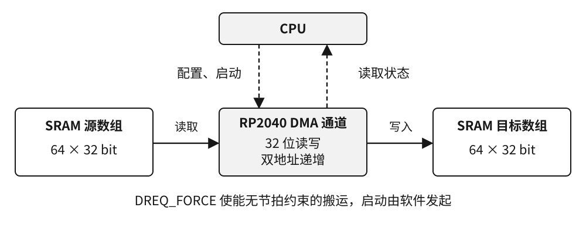
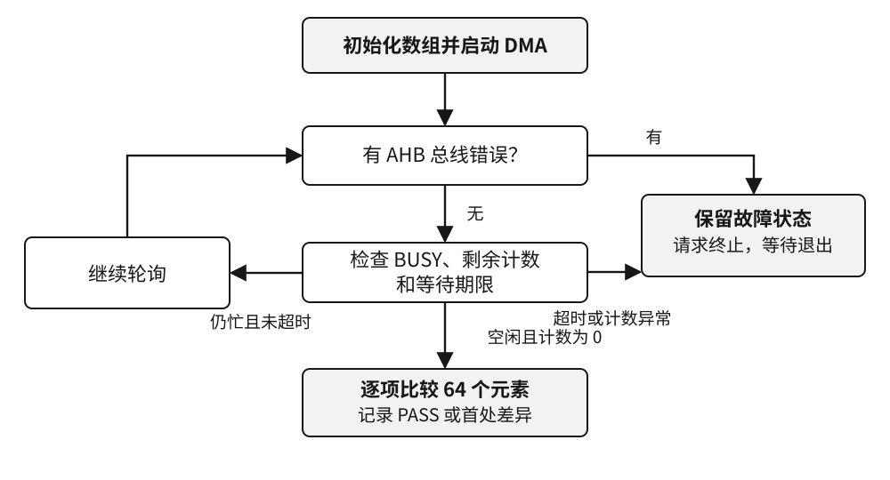

# RP2040 DMA 从 SRAM 到 SRAM

本章使用搭载 RP2040 的第一代 Raspberry Pi Pico 和 Pico SDK 2.2.0。实验把 64 个 32 位整数从片内 SRAM 的一个数组搬到另一个数组。学习者需要能读懂 C 数组和指针。完成实验后，应能解释搬运计数的单位，区分通道停止、硬件总线错误和数据不匹配，并用串口或调试器检查结果。

## 1 DMA 通道的工作过程

CPU 先初始化两个数组，再为 DMA 通道设置读地址、写地址、传输宽度、次数和请求来源，最后启动通道。传输开始后，DMA 作为总线主设备读取源元素并写入目标地址。每次传输后两个地址各前移 4 字节，剩余传输计数递减。通道处理完最后一次写入后，软件可以检查完成状态并读取目标缓冲区。图 1 的实线表示数据流，虚线表示 CPU 的配置和状态读取。[1]

图 1 RP2040 SRAM 到 SRAM 搬运原理图

外设的数据请求（DREQ）通常为 DMA 提供节拍。例如，接收 FIFO 中有数据时才允许发起读操作。本实验的两个数组都在 SRAM，使用 `DREQ_FORCE` 选择永久请求，通道不等待外设节拍。设置永久请求和启动通道是两个动作。代码通过配置函数的最后一个参数触发启动。[1][2]

## 2 参数与寄存器对应关系

数据宽度是 32 位，即每个元素 4 字节。64 个元素共 256 字节，因此 `TRANS_COUNT` 的初值为 64。若把字节数 256 直接传给配置函数，DMA 将尝试搬运 256 个 32 位元素，即 1024 字节，超过两个数组的范围。`uint32_t` 数组为本实验提供所需的自然对齐，代码还用编译期断言确认源数组占 256 字节。[1][2]

表 1 一次 SRAM 搬运的通道配置

| 项目 | 本实验设置 | 寄存器字段或 SDK 入口 |
| --- | --- | --- |
| 源、目标 | 两个独立 SRAM 数组 | `READ_ADDR`、`WRITE_ADDR` |
| 搬运宽度 | 每次 32 位 | `DATA_SIZE`、`DMA_SIZE_32` |
| 地址步进 | 读、写地址均递增 | `INCR_READ`、`INCR_WRITE` |
| 搬运次数 | 64 次，共 256 字节 | `TRANS_COUNT`、`dma_encode_transfer_count(64)` |
| 请求与启动 | 永久请求，由软件触发 | `TREQ_SEL`、`DREQ_FORCE`、`dma_channel_configure` |
| 链接与环绕 | 本通道号指定为 `CHAIN_TO`，环绕关闭 | `dma_channel_get_default_config` |
| 完成判定 | 轮询通道控制状态和剩余计数 | `BUSY`、`AHB_ERROR`、`TRANS_COUNT` |

SDK 默认配置使读地址递增、写地址固定。若沿用默认写地址，64 次写操作会覆盖同一个目标字。因此程序清单 1 显式打开双地址递增。代码也明确给出宽度和节拍方式，便于对照表 1。配置函数按“写地址、读地址”的次序接收两个数组指针。[2]

程序清单 1 配置通道并发出启动触发

@code src/main.c start_copy

## 3 判断完成并校验数据

每次轮询先检查 `AHB_ERROR`。它汇总读、写总线错误。若有错误，记录控制寄存器和剩余计数。无总线错误时，`BUSY=0` 且剩余计数为 0 才进入数据校验；仅看 `BUSY=0` 不能区分正常完成和通道因错误停下。仍忙的通道达到等待期限时报告 `TIMEOUT`。10 ms 是本实验的等待上限，实际搬运用时需要另行测量。[1]

图 2 轮询与异常处理流程

程序清单 2 读取控制状态、剩余计数和时间

@code src/main.c observe_copy

发生总线错误、计数异常或超时时，`observe_copy` 保存终止前的状态快照。随后 `stop_failed_copy` 使用 `CHAN_ABORT` 请求终止，并限时等待 `BUSY` 清零。单独清 `EN` 只能暂停通道。根据 RP2040-E13，终止进行中的通道可能使原始中断位置位，本程序屏蔽该通道的两个 DMA IRQ 路由，确认空闲后按写一清零规则清对应的 `INTR` 位。通道错误或超时后，程序保留通道和两个静态缓冲区，复位后才重新做实验。[1][2]

通道完成后，CPU 逐个比较两个数组，遇到首个差异就记录下标和双方的值。初始源值取 `0x31A50000 + 257 × i`，其中 `i` 为 0 到 63。目标数组预填 `0xDEADBEEF`，便于发现部分搬运和写地址未递增。首项应为 `0x31A50000`，末项应为 `0x31A53F3F`。全量比较覆盖两个端点之间的 62 项。

程序清单 3 逐项比较并记录首处差异

@code src/main.c first_mismatch

## 4 构建和上板实验

使用 GNU Arm Embedded 交叉编译器、Pico SDK 2.2.0、CMake 和 Ninja。打开 `README.md`，按命令指定 `PICO_BOARD=pico` 构建 `rp2040_dma`。有 `picotool` 的构建可产生 UF2，用 Pico 的 BOOTSEL 模式下载。有 SWD 调试探针时可加载 ELF，并查看 `dma_report`。本实验只用片内 SRAM，DMA 通路无需外接信号。[3][4]

程序通过 UART0 输出报告。可将 Pico 的 GP0（排针 1）接到 3.3 V 逻辑电平 USB–UART 转换器的 RX，连接公共地，串口设置为 115200、8N1。只观察输出时无需连接转换器的 TX。实验开机执行一次，每 2 s 重新打印同一份报告。[3][4]

表 2 两种构建的预期结果

| 构建 | 预期通道状态 | 预期数据结果 |
| --- | --- | --- |
| 正常 | `BUSY=0`、`AHB_ERROR=0`、`remaining=0` | `PASS`，64 项匹配，首项 `0x31A50000`、末项 `0x31A53F3F` |
| 软件注入差异 | `BUSY=0`、`AHB_ERROR=0`、`remaining=0` | `MISMATCH`，下标 17，预期 `0x31A51111`、实际 `0x31A51110` |

第二种构建在 DMA 正常停止后由 CPU 翻转目标数组下标 17 的最低位，用于验证程序清单 3 能发现坏数据。`READ_ERROR` 和 `WRITE_ERROR` 是独立的硬件诊断，本实验通过读取标志观察其状态。`VERIFICATION.md` 记录已执行的检查，表 2 为可据源码推导的验收值。

## 5 练习

1. 若把每个元素改为 16 位，仍搬运 64 项，传输计数、数组总字节数和两个地址的步进分别是多少？
2. 若漏掉 `channel_config_set_write_increment`，用程序清单 3 判断正常构建最先在哪个下标报告差异，并解释源、目标地址如何变化。
3. 对比 `TIMEOUT` 与 `BUS_ERROR` 的控制状态和剩余计数。为什么诊断快照要在发出 `CHAN_ABORT` 前保存？
4. 阅读参考手册的 DREQ 表。若把源数组改为某个外设的接收 FIFO，说明读地址递增和请求选择要如何改变，列出需核对的 FIFO 宽度和可用 DREQ 资源。

配套资料 [练习答案要点](exercise-notes.md) 可用于核对推导。

## 资料

- [1] Raspberry Pi，《RP2040 Datasheet》，build `3184e62-clean`，2025-02-20。第 2.5.1–2.5.4 节（印刷页 92–96）说明通道寄存器、触发和请求，第 2.5.5.3 节（印刷页 97）说明终止和 E13，第 2.5.7 节的 `CH0_CTRL_TRIG`（印刷页 112）列出状态位。[原厂手册](https://datasheets.raspberrypi.com/rp2040/rp2040-datasheet.pdf)
- [2] Raspberry Pi，Pico SDK 2.2.0。以 `dma_channel_get_default_config`、`dma_encode_transfer_count`、`dma_channel_configure`、`dma_channel_is_busy` 和 `dma_channel_abort` 为定位点。[固定版本 DMA 头文件](https://github.com/raspberrypi/pico-sdk/blob/2.2.0/src/rp2_common/hardware_dma/include/hardware/dma.h)
- [3] Raspberry Pi，Pico SDK 2.2.0 的第一代 Pico 板配置。[固定版本板定义](https://github.com/raspberrypi/pico-sdk/blob/2.2.0/src/boards/include/boards/pico.h)
- [4] Raspberry Pi，Pico C/C++ SDK 与第一代 Pico 板卡资料。[SDK 文档](https://www.raspberrypi.com/documentation/microcontrollers/c_sdk.html) · [板卡数据手册](https://datasheets.raspberrypi.com/pico/pico-datasheet.pdf)
