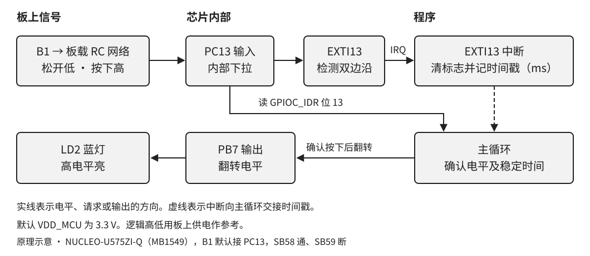
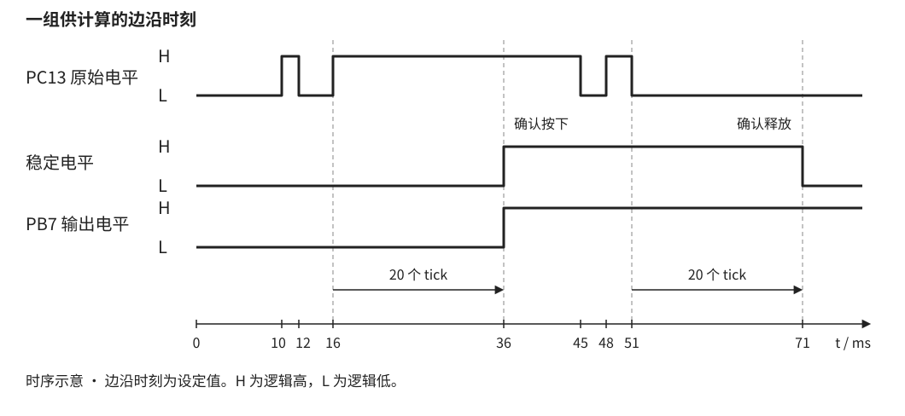

# STM32U575 GPIO 按键中断与消抖

按一下 B1，蓝灯 LD2 翻转一次。一直按住或松开，灯保持原状。学过 C 的变量、函数和 `if`，就可以用这个实验追踪一次按压如何从引脚变成软件事件，并用调试器说明为什么回调次数可能多于按压次数。

## 1 从 B1 到 LD2

本章选用 NUCLEO-U575ZI-Q（MB1549），目标芯片 STM32U575ZIT6Q，LQFP144 SMPS 封装。采用出厂 3.3 V 配置，SB58 导通、SB59 断开。蓝色 B1 默认接 PC13，松开为低，按下为高。蓝灯 LD2 由 PB7 驱动，PB7 为高时点亮。黑色 B2 用于复位。芯片的 PC13、PB7 分别为封装第 7、136 脚。实验板未接入当前验证环境，实物版本、焊桥和供电要在上板时核对。

B1 的板载滤波网络包含 330 Ω 串联电阻 R39、100 kΩ 下拉电阻 R38 和 100 nF 电容 C84。GPIOC 的内部下拉也参与电路。触点闭合或断开时可能短暂反复接触，RC 网络会改变芯片引脚上看到的边沿。板上一次按压只见到一次上升沿也符合预期。PC13 始终配置为带下拉的输入。

PC13 的电平可由 GPIOC 的 `IDR` 读出。它还接到 EXTI13 的输入选择器。EXTI13 可从若干端口中选一个编号为 13 的引脚，本章选择端口 C。上升沿和下降沿分别置位各自的挂起位，再经中断屏蔽位和 NVIC 送到 CPU。NVIC 是内核的中断控制器。`EXTI13_IRQHandler` 是启动向量表给 EXTI13 留的入口名。

## 2 由边沿确认按压

边沿描述电平刚刚变化。程序确认的是在一定时间后仍保持的新电平。两种边沿都记录时间戳，每次新边沿重新开始等待。满 20 个 tick 后，主循环读到的电平若与已确认电平不同，就接受新电平。低变高时翻灯并计数，高变低时重新准备接收下一次按压。

按图 2 计算，10 ms 和 12 ms 的边沿都被后续边沿覆盖。16 ms 后再无边沿，35 ms 的差值为 19，36 ms 才达到 20 并确认按下。释放段最后一次边沿在 51 ms，71 ms 确认释放。释放后 LED 仍亮，下一次确认按下才会熄灭。

程序沿用复位时 4 MHz 的 MSIS 和默认分频。`HAL_Init()` 选 HCLK 作为 SysTick 时钟，`HAL_InitTick()` 按默认 1 kHz 时基设置 SysTick。标称计数周期是 4000 个 HCLK，重装值为 3999，`SysTick_Handler()` 每次调用 `HAL_IncTick()`。阈值 20 以 1 ms tick 为单位，示波器量到的是最后一个 PC13 可见边沿到 PB7 翻转的时间，受 tick 量化、时钟精度和处理延迟影响。软件与板载 RC 的时间效果分别观察。

## 3 对照关键配置

表 1 本实验使用的寄存器和 SDK 符号

| 功能 | 寄存器字段 | HAL1 配置或读写 |
| --- | --- | --- |
| 接通端口时钟 | `RCC_AHB2ENR1.GPIOBEN`、`GPIOCEN` | `__HAL_RCC_GPIOB_CLK_ENABLE()`、`__HAL_RCC_GPIOC_CLK_ENABLE()` |
| PC13 输入并下拉 | `GPIOC_MODER[27:26] = 00`、`GPIOC_PUPDR[27:26] = 10` | `GPIO_MODE_IT_RISING_FALLING`、`GPIO_PULLDOWN` |
| EXTI13 选择 C | `EXTI_EXTICR4[15:8] = 0x02` | `HAL_GPIO_Init(GPIOC, &gpio)` |
| 两种边沿都请求 IRQ | `EXTI_RTSR1`、`EXTI_FTSR1`、`EXTI_IMR1` 的位 13 置 1 | `GPIO_MODE_IT_RISING_FALLING` |
| 读与清边沿挂起 | `EXTI_RPR1`、`EXTI_FPR1` 的位 13。写 1 清对应位 | `HAL_GPIO_EXTI_IRQHandler(GPIO_PIN_13)` 分开处理两种边沿 |
| 读输入与翻转输出 | `GPIOC_IDR` 位 13、`GPIOB_ODR` 位 7、`GPIOB_BSRR` | `HAL_GPIO_ReadPin()`、`HAL_GPIO_TogglePin()` |

`GPIO_PIN_13` 是位掩码 `0x2000`。`EXTI13_IRQn` 是 CMSIS 中编号为 24 的外部中断，两者分别用于线路位掩码和 NVIC 入口。`RPR1` 和 `FPR1` 用写 1 清除指定标志，调试时应观察，不要用读改写的方法清它们。

## 4 初始化与关键程序

`main()` 先检查 `HAL_Init()`。失败时停在空循环，可在调试器中查看返回值。成功后开端口时钟，先将 PB7 输出锁存值置低，再配置推挽输出，确保灯从熄灭起步。接着配置 PC13 为双边沿中断输入。程序清除 EXTI 两种挂起位，再清 NVIC 挂起，读取开机电平作为初始稳定状态，最后才使能 `EXTI13_IRQn`。若复位时 B1 被按住，这个初始高电平不会增加按压计数。释放稳定后才能接收下一次按下。

程序清单 1 配置输出和按键输入（`project/Core/main.c`）

@code project/Core/main.c gpio-init

程序清单 2 中断入口及两种回调（`project/Core/main.c`）

@code project/Core/main.c exti

HAL1 的 GPIO 中断处理函数在调用回调前清对应的挂起位。两个回调共享 `Record_Button_Edge()`，只写最新边沿时间和回调计数。`g_exti_callback_count` 统计实际执行的回调，同一边沿类型的多个物理跳变可能合并在一个挂起位中。SysTick 优先级为 4，EXTI13 为 5，数值较小者优先。中断内保持短小，让时基继续运行。

程序清单 3 清挂起并启用 NVIC（`project/Core/main.c`）

@code project/Core/main.c arm-exti

程序清单 4 读取一次一致的状态快照（`project/Core/main.c`）

@code project/Core/main.c poll

`last_edge_ms` 由中断更新，`volatile` 让主循环确实读取该值。为了让 tick、上次边沿时间和电平相互对应，主循环短暂屏蔽普通中断，再恢复原来的 PRIMASK。屏蔽期间 EXTI 硬件仍能置挂起位。如果采样后读到挂起位，本轮结果丢弃，由中断处理新边沿后再取样。LED 只由主循环修改，按压计数也只在这里递增。

程序清单 5 确认电平与决定是否翻灯（`project/Core/button.c`）

@code project/Core/button.c confirm

`stable_high` 由主循环持有。`Button_Confirm()` 通过指针更新它，返回 `true` 表示一次确认按下。`now_ms - edge_ms` 使用 `uint32_t` 的模运算，正常工作时即使跨过 `UINT32_MAX` 也能测出短间隔。本例在正常运行时持续轮询，完整的 32 位 tick 周期约 49.7 天，不能据这两个计数器区分跨越整周期的间隔。

## 5 在 Keil MDK 5 构建与实验

### 5.1 打开工程和下载

1. 安装 Keil MDK 5、Arm Compiler 6.19 或支持 Cortex-M33 和 Arm 语法汇编的 AC6，以及 `Keil.STM32U5xx_DFP.3.2.0`。在 Pack Installer 核对器件 `STM32U575ZITxQ`。工程使用 HAL1 v1.6.3，配套的 CMSIS、启动文件和驱动置于 `project/Drivers`。
2. 打开 `project/MDK-ARM/GPIO_EXTI.uvprojx`，选择 `GPIO_EXTI`。在 Options for Target 核对 Arm Compiler 6、C99、宏 `STM32U575xx` 和 `USE_HAL_DRIVER`。在 Asm 页核对 `armasm (Arm Syntax)`，并在 Linker 页关闭 Use Memory Layout from Target Dialog，选 `GPIO_EXTI.sct`。启动汇编只编入一份。
3. 工程以 `TZEN=0` 的单镜像方式从用户 Flash 启动。确认板处于这个实验前提。点击 Rebuild，保存实际编译器版本和 Build Output。检查生成的 AXF 与 map。复位向量应在 `0x08000000`，读写段和栈堆放在从 `0x20000000` 开始的 192 KiB SRAM1。若无 map，在 Listing 页启用 Linker Listing 后重建。
4. 确认 JP6 为 1–2，USB 数据线连接 STLINK-V3E 的 CN1，板上默认供电为 3.3 V。在 Debug 页选 ST-Link Debugger 和 SWD，Utilities 的 Flash Download 选择从 `0x08000000` 起覆盖 2 MiB 的 STM32U575 内部 Flash 下载算法，并启用 Reset and Run。下载后复位并运行。

### 5.2 先观察电平再统计按压

1. 初次运行先在 `Board_GPIO_Init()` 返回后观察 `GPIOC_IDR` 的位 13。分别在松开和按住 B1 时读，应得到 0 和 1。可在 `EXTI13_IRQHandler()` 入口短暂停一次，确认向量进到了应用函数。随后清除断点并复位，运行以下计数测试。
2. 把 `g_press_count`、`g_exti_callback_count` 加入 Watch。释放 B1 并复位，连续缓慢按放 10 次，每次高、低各保持至少 100 ms，再暂停读取。预期每按一次灯翻转，`g_press_count` 增加 10，灯回到初始熄灭。`g_exti_callback_count` 记录上下两种边沿，干净波形时预期增加 20，有可见抖动时可能更多。
3. 按住约 2 秒再松开，预期整个操作只多计一次。再做一次按住 B1 复位。等程序运行后松开，预期计数仍为 0。再次按压时计数变为 1。
4. 有双通道仪器时，在 CN11 接 CH1 至 pin 23（PC13）、CH2 至 pin 21（PB7），两探头共接 pin 22（GND），在 3.3 V 板上以 PC13 上升沿触发，起始用 5 ms/div。采用高阻探头，记录从最后一次可见输入边沿到输出翻转的时间。在自由运行时采样，断点会改变时序。确认探针与连接器位置后再通电。
5. 如果板载 RC 已滤掉可见抖动，用 `evidence/test_button.c` 的合成时间戳复现抖动与短脉冲。它调用同一份 `Button_Confirm()`，逐个检查 19 和 20 tick、长按、带抖动释放、短脉冲、按住复位所用的初始条件与 tick 回绕。

### 5.3 根据观察定位故障

| 观察 | 优先检查 |
| --- | --- |
| B1 动作时 `IDR` 位 13 不变 | 板型、SB58/SB59、电源、GPIOC 时钟和下拉输入 |
| `IDR` 变化，回调计数不变 | EXTI13 端口选择和两种触发位、`IMR1`、NVIC、启动入口符号 |
| 回调有计数，按压始终为零 | `SysTick_Handler` 是否执行，`uwTick` 是否递增，是否在暂停状态 |
| 按压计数正确而灯不变 | 检查 PB7 的 `MODER`、`ODR` 与 LD2 是否对应实物 |

本次通过主机算法用例、HAL1 接口语法、工程路径与向量静态检查。MDK 目标编译、链接、下载、示波器数据需在装有工具链和连接实板后填写。[验证记录](evidence/verification.md)

## 6 练习

1. 若 4 MHz 的 HCLK 改为 8 MHz，1 kHz tick 对应的重装值是多少？20 个 tick 的消抖门限有何变化？答题要点是 `8000000 / 1000 - 1 = 7999`，时基仍为 1 ms，软件门限仍为 20 个 tick。改时钟后需要重新配置 SysTick。
2. 如果只打开上升沿，释放抖动中一段较长低电平可能在哪个环节提前被确认？画出低、高、低三次电平变化，比较最后边沿时间与释放确认的时间。答题要点是下降沿不再刷新时间戳，释放时等待窗口可能从旧上升沿算起，导致尚未稳定的低电平使程序重新接受按下。

## 7 资料定位

- ST UM2861 Rev 10，§7.4.1 供电、§7.5–7.6 LED 与 B1、表 19 探头引脚。 [Nucleo-144 用户手册](https://www.st.com/resource/en/user_manual/dm00789949.pdf)
- ST DS13737 Rev 10，图 18 LQFP144_SMPS 引脚。 [STM32U575 器件资料](https://www.st.com/en/microcontrollers-microprocessors/stm32u575-585/documentation.html)
- ST RM0456 Rev 7，§11.4.9 SYSCLK、§13.4 GPIO 寄存器、§22 NVIC 向量表、§23.3.2 EXTI 选择器、§23.6.1–23.6.5 和 §23.6.8–23.6.11 EXTI 寄存器。 [STM32U5 参考手册入口](https://www.st.com/en/microcontrollers-microprocessors/stm32u5-series/documentation.html)
- ST ES0499 Rev 12，§2.2.1 提示 LQFP 封装的 PC13 跳变可能扰动 LSE 晶振，§2.2 的 EXTI LOCK 勘误涉及权限锁定。本实验采用 MSIS/HCLK 时基，未启用 LSE，也未设置 EXTI 锁定。 [STM32U575 勘误](https://www.st.com/content/st_com/en/technical-documents/es0499-stm32u575xx-and-stm32u585xx-device-errata-stmicroelectronics.html)
- HAL1 v1.6.3，`stm32u5xx_hal_gpio.c` 的 `HAL_GPIO_Init`、`HAL_GPIO_EXTI_IRQHandler`、`HAL_GPIO_ReadPin`、`HAL_GPIO_TogglePin`，`stm32u5xx_hal_gpio.h` 的挂起位读清宏，`stm32u5xx_hal.c` 的 `HAL_Init`、`HAL_InitTick` 和 `HAL_GetTick`。CMSIS 设备头 `stm32u575xx.h` 的 `EXTI13_IRQn`，以及 `startup_stm32u575xx.s` 的 EXTI13 和 SysTick 向量。 [ST HAL1 驱动](https://github.com/STMicroelectronics/stm32u5xx-hal-driver)
- Keil 器件选择与汇编选项。 [STM32U575ZITxQ](https://www.keil.arm.com/devices/stmicroelectronics-stm32u575zitxq/features/) [Asm 设置](https://www.keil.com/support/man/docs/uv4/uv4_dg_adsas.asp)
